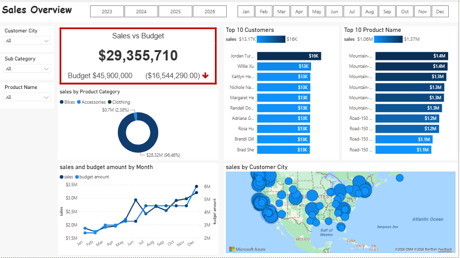
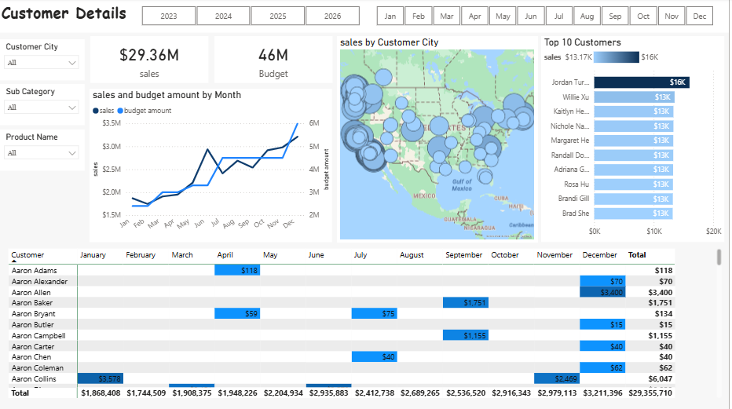
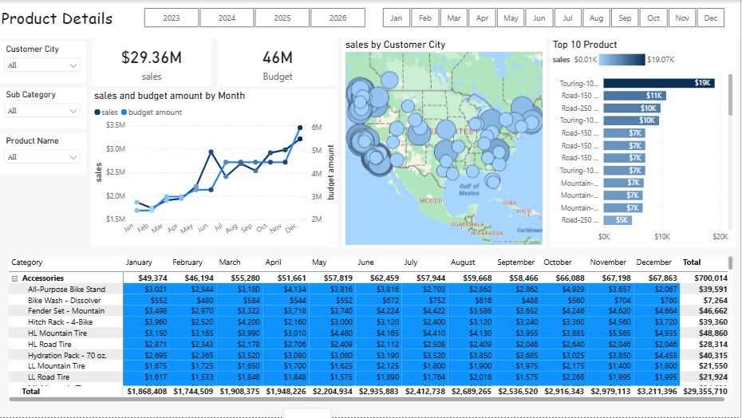
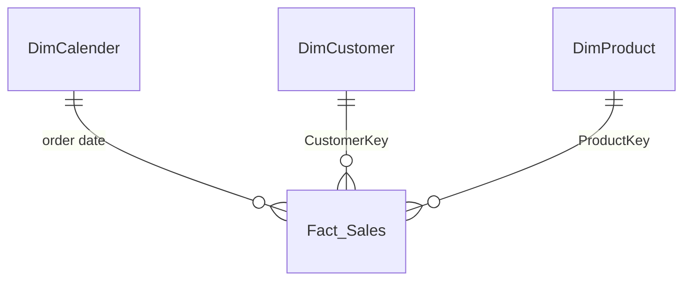

# 📊 Sales vs Budget Report – Power BI

## 📋 Project Overview
A three-page **Power BI report** that compares actual sales with the budget and lets the reader drill into customers and products. The data comes from Microsoft's **AdventureWorksDW2025** sample data warehouse on SQL Server. SQL queries clean and shape the source tables into a **star schema**, and a separate budget table is added for the comparison.

The data is a Microsoft **sample dataset**, used here for learning and portfolio purposes.

---

## 🖼️ Report Preview

**Sales Overview**

**Customers**

**Product Details**

---

## 🔎 Headline Results
Across the full period shown in the report:

| Metric | Value |
|--------|-------|
| Sales | $29,355,710 |
| Budget | $45,900,000 |
| Variance (sales − budget) | −$16,544,290 |
| Sales as a share of budget | about 64% |
| Share of sales from Bikes | 96.46% |

---

## 📑 Report Pages

| Page | What it shows |
|------|---------------|
| **Sales Overview** | Sales vs Budget KPI with variance indicator, sales by product category, top 10 customers, top 10 products, sales and budget by month, sales by customer city |
| **Customers** | Sales and budget cards, monthly trend, customer map, top 10 customers, and a customer × month matrix with totals |
| **Product Details** | Sales and budget cards, monthly trend, customer map, top 10 products, and a category → sub-category → product × month matrix |

**Interactivity:** year buttons, month buttons, and slicers for customer city, sub-category and product name, shared across the pages.

---

## 🧱 Data Model

| Table | Main columns |
|-------|--------------|
| **Fact_Sales** | `ProductKey`, `OrderDateKey`, `DueDateKey`, `ShipDateKey`, `CustomerKey`, `SalesOrderNumber`, `SalesAmount` |
| **DimCalender** | `DateKey`, `Date`, `Day`, `WeekNr`, `Month`, `MonthShort`, `MonthNo`, `Quarter`, `CalendarYear` |
| **DimCustomer** | `CustomerKey`, `FirstName`, `LastName`, `Full Name`, `Gender`, `DateFirstPurchase`, `CommuteDistance`, `Customer City` |
| **DimProduct** | `ProductKey`, `ProductItemCode`, `Product Name`, `Product Category`, `Sub Category`, `Product Color`, `Product Size`, `Product Line`, `Product Model Name`, `Product Description`, `Product Status` |
| **SalesBudget** | Budget amounts, compared with actual sales in the report |
| **KPImeasure** | Holds the report's measures |

---

## 🛠️ Data Preparation (SQL)
Each query below is the source of the matching table in the report. They read from `AdventureWorksDW2025` and keep only the columns the report needs.

| File | What it does |
|------|--------------|
| `Dim_Calender1.sql` | Cleaned date dimension: renamed columns, `MonthShort` (first three letters of the month), `CalendarYear >= 2019` |
| `Dim_Customer.sql` | Customer dimension: full name, `M`/`F` mapped to Male/Female, city joined in from `DimGeography` |
| `Dim_Product.sql` | Product dimension: category and sub-category joined in, missing status replaced with `Outdated` |
| `Fact_Sales.sql` | Fact table from `FactInternetSales`: keys and `SalesAmount` only, orders from 2023 to 2026 |
| `Dim_Calender.sql` | Script that shifts AdventureWorksDW dates to recent years (see credits) |

Products without a sub-category are excluded by the inner joins in `Dim_Product.sql`.

---

## ▶️ How to Open the Report
1. Open `sales report.pbix` in **Power BI Desktop**.
2. To refresh the data, restore the **AdventureWorksDW2025** sample database on a SQL Server instance.
3. In **Home → Transform data → Data source settings**, point the SQL Server source to your server.

---

## 🙏 Credits
- **AdventureWorksDW2025** – Microsoft sample data warehouse.
- `Dim_Calender.sql` – date-shifting script by David Alzamendi (techtalkcorner.com), kept with its original header.

---

## 🚧 Future Work
- Add a year-over-year comparison
- Add budget by product category

---

## 🧑‍💻 Author
**Salma Ahmed Khogali**  
📍 Riyadh, Saudi Arabia  
📧 [saloomkhogali10@gmail.com](mailto:saloomkhogali10@gmail.com)  
💼 Bachelor's in IT – University of Khartoum  
📜 Microsoft PL-300 – Power BI Data Analyst Associate
